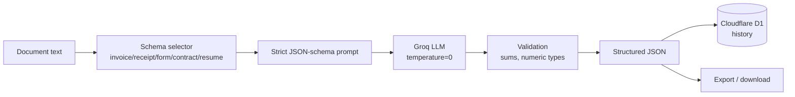

# 04 — Document Vision System (Structured Extraction)

**Project 04 of 50 — AI Engineering Portfolio**

Turn unstructured documents — **invoices, receipts, forms, contracts, résumés** — into **validated structured JSON** using an LLM with strict per-type schemas, with a persisted history and export.

## 🌐 Live Demo
- **App:** https://document-vision-system.deepvision-aiportfolio.workers.dev
- **GitHub:** https://github.com/deepvisionkararhaider-crypto/document-vision-system

## 🎯 Problem
Businesses receive invoices, receipts and forms as free text or scans. Finance, HR and legal teams re-key this data by hand. This system extracts it into typed, validated JSON that downstream systems can consume directly.

## 🏗️ Architecture

**Schema enforcement:** each document type has an explicit JSON schema injected into a strict extraction prompt; the response is parsed defensively (fenced-code tolerant) and validated (e.g. line-item sums vs subtotal).

## ✨ Features
- 6 document schemas: invoice, receipt, form, contract, résumé, generic
- Strict JSON-schema prompting, temperature 0, defensive parsing
- Validation checks (numeric types, line-item sum vs subtotal) with warnings
- Persisted extraction history in D1 with per-item retrieval
- Table rendering + raw JSON view + JSON download
- Sample documents per type
- Error handling + smoke tests

## 🛠️ Stack
Cloudflare Workers · Hono · Groq LLM · Cloudflare D1 · TailwindCSS

## 📁 Structure
`src/worker.js` (schemas, extraction, validation, API, UI) · `src/core.js` (Groq client)

## 🔑 Env
```bash
GROQ_API_KEY=          # secret
LLM_MODEL=openai/gpt-oss-120b
```

## 🚀 Run
```bash
npm install
echo "GROQ_API_KEY=your_key" > .dev.vars
npm run dev && BASE=http://localhost:8787 bash tests/smoke.sh
```

## 📡 API
| Method | Endpoint | Description |
|--------|----------|-------------|
| GET | `/api/health` | Health |
| GET | `/api/stats` | Counts + supported types |
| GET | `/api/samples` | Sample documents |
| POST | `/api/extract` | `{text, doc_type, filename}` → structured JSON |
| GET | `/api/extractions` | History |
| GET | `/api/extractions/:id` | One result |
| DELETE | `/api/extractions/:id` | Delete |

## 🧪 Testing
**Verified:** `6 passed, 0 failed` (health, doc types, invoice extraction, fields present, malformed input, persisted history).

**Live example:** extracting `INV-2043` returned `invoice_number`, vendor/customer, `line_items` with numeric `quantity/unit_price/amount`, and `subtotal/tax/total` — correctly typed.

## ⚠️ Limitation (honest)
This system extracts from **document text**. OCR for scanned images/PDFs is a listed future improvement. The extraction, schema enforcement, validation, persistence and export are fully real.

## 🔮 Future Improvements
- OCR / vision ingestion for scans and photos
- PDF page rendering to images + multimodal model
- Multi-document batch extraction
- Export to CSV / Excel

## 📄 License
MIT.
